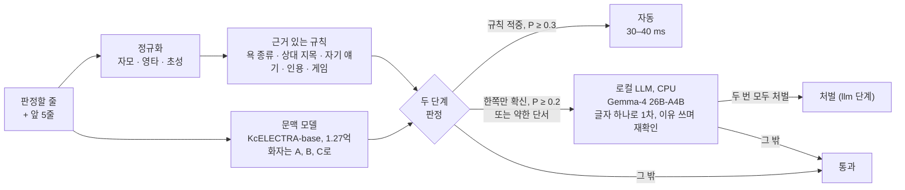

# korean-chat-moderation

CPU만으로 도는 한국어 게임 채팅 감시입니다. 근거를 남기는 규칙이 철자를 어떻게 바꿔도 욕을 찾고, 미세조정한 문맥
모델이 판정할 줄 앞의 5줄을 함께 읽고, 앞의 둘이 확신하지 못하는 줄만 로컬 LLM이 다시 봅니다. 이용자 대부분이
10대인 한국 마인크래프트 생존 서버를 위해 만들었고 2026년 10월부터 실제로 쓰고 있습니다.

[English README](README.md)

> 주의: 규칙 사전과 `data/`의 AI 작성 자료에는 노골적인 한국어 욕설이 들어 있습니다.



## 결과

시험 세트는 AI가 쓴 문장이고 학습에 쓰지 않았습니다. 실제 채팅은 개수만 적습니다. 수치는 실제로 배포한 모델로 잰
것이고, 이 모델은 이 저장소의 자료에 실제 채팅 12,500줄을 정상 예시로 더해 학습했습니다(그 채팅과 가중치는 공개하지
않습니다. [개인정보](#개인정보) 참고).

| 시험 | 잡은 심한 말 | 정상인데 걸린 줄 |
|---|---|---|
| AI 작성 대화 `blind-ctx-2` (심한 말 100, 정상 200) | 92 (자동 49 + 검토 43) | 검토 12, **자동 0** |
| AI 작성 한 줄 `blind-test-2` (심한 말 120, 정상 200) | 120 (자동 71 + 검토 49) | 검토 2, **자동 0** |
| `blind-ctx-2`의 어려운 215개, 배포한 LLM 단계 포함 (심한 말 80, 정상 135) | 71 처벌 (자동 30 + LLM 41) | **0** |
| 실제 채팅, 시간순 마지막 15% (2,632줄) | | 검토 2, 자동 0. LLM까지 간 줄 4개 (0.15%) |
| 실제 사건 줄 (20) | 19 (자동 18 + 검토 1) | |
| 운영 첫 17시간 (454줄) | 욕설 사건 없음 | 홍보 오판 뮤트 1건, 풀고 고침 |

| 단계 | 한 줄 비용 | 거치는 줄 |
|---|---|---|
| 규칙 | 1 ms 미만, 순수 파이썬 | 전부 |
| 문맥 모델 | CPU 4스레드로 30–40 ms | 전부 |
| LLM 1차 (출력 토큰 1개) | 평균 2.8초 | 실제 채팅의 약 0.15% |
| LLM 재확인 (이유가 있는 JSON) | 약 10초 추가 | 1차에서 처벌이 나온 줄만 |

하드웨어: 오래된 2소켓 서버 한 대(2016년 CPU, 소켓당 22코어), GPU 없음, 게임 서버와 같은 머신. 요청당 비용 없음.

## 이렇게 만든 이유

**좁은 기준.** 다른 플레이어를 향한 심한 말만 처벌합니다. 패드립(상대의 부모·가족 모욕), 상대에게 퍼붓는 쌍욕,
장애·인종·출신 비하, 성희롱입니다. 크리퍼·렉·자기 자신에게 한 욕, 가벼운 놀림, 신조어, 게임 속 위협("죽인다")은
통과입니다. 기성 한국어 혐오 분류기는 맞지 않았습니다. `smilegate-ai/kor_unsmile`은 실제 사건 20줄 중 19줄을 잡았지만
시험에 넣은 평범한 욕도 모두 잡았습니다.

**규칙이 먼저, 그러나 혼자서는 처벌하지 않음.** 기호, 숫자, 끼워 넣은 글자, 초성, 영타로 욕을 숨깁니다. 정규화 뒤
자모 문자열에서 찾으면 이 모두를 싸게 처리하고 왜 걸렸는지도 정확히 남습니다. 규칙이 모르는 것은 그 말이 누구를
향했는지, 신고를 인용한 것인지, 몹에게 한 욕인지입니다. 그래서 규칙 적중마다 근거(상대 지목, 자기 얘기, 인용, 게임
단서)를 붙이고, 독립된 두 번째 신호가 동의할 때만 자동이 됩니다.

**문맥이 결정함.** "빨리 가시라고 해 ㅋㅋ"는 "할머니가 집에 오셨어" 뒤에서는 별일 아니지만 "할아버지 입원하셨어"
뒤에서는 죽음을 조롱하는 말입니다. (앞 5줄, 판정할 줄)을 함께 읽는 교차 인코더가 이것을 대조 쌍에서 배웁니다.
같은 줄을 한 번은 심한 문맥에, 한 번은 무해한 문맥에 둔 예시입니다. 화자 이름은 A, B, C로 바꿔서 누가 누구에게
말하는지만 배우고 누구인지는 배우지 않습니다.

**두 단계.** 자동은 규칙과 모델이 모두 동의해야 합니다. 한쪽만 확신하면 검토로 갑니다. 목록에 있는 단어가 없는
돌려 말한 모욕(규칙은 40개 중 0개, 모델이 32개를 검토로 보냄), 문맥상 아니라고 본 규칙 적중, 몹 이름이 들어간 욕이
여기에 해당합니다. 어느 시험 세트에서도 정상 줄이 자동까지 간 적은 없습니다.

**추론이 필요한 줄에만 LLM.** CPU에서 26B MoE 모델은 한 줄에 몇 초가 걸려 모든 채팅을 읽을 수 없습니다. 앞 단계가
의심한 0.15%만 읽습니다. 먼저 문법 제약으로 글자 하나만 답하게 하고(약 3초), "처벌"이 나온 줄만 이유를 쓰며 다시
묻고, 두 번 모두 처벌일 때만 처벌합니다.

**전부 내부에서.** LLM은 같은 머신의 llama.cpp 서버입니다. 채팅이 밖으로 나가지 않고 API 요금도 없습니다. 이전에
쓰던 유료 감시 API를 대체했습니다.

## 단계별 동작

### 정규화 `kcm/normalize.py`

| 수법 | 예 | 처리 |
|---|---|---|
| 글자 사이 기호·숫자·띄어쓰기 | `병.신`, `병1신`, `병 신` | `squeeze()`는 글자만 남김, `light()`는 한글 사이 기호 2개까지 제거 |
| 전각 문자, 긴 반복 | `ＡＢＣ`, `ㅋㅋㅋㅋㅋ` | NFKC, 반복은 2개로 |
| 겹글자를 나눠 치기 | `ㅄ` / `ㅂㅅ`, `ㅘ` / `ㅗㅏ` | `jamo()`가 음절과 겹글자를 낱자로 분해 |
| 끼워 넣은 글자 | `씨이발`, `병으응신` | 규칙 패턴이 음절 사이 으·응·이를 허용 |
| 영타 | `qudtlsdk` = 병신아 | `engkey()`(규칙용 자모), `eng2han()`(모델용 음절, 모든 키가 흔한 음절이 될 때만) |
| 초성 | `ㄴㄱㅁ`, `ㅅㅂㄹ아` | 초성 전용 패턴 |

### 근거 있는 규칙 `kcm/rules.py`

패턴 24개와 초성 패턴 3개를 네 가지 형태에 적용합니다. 띄어쓰기를 둔 자모, 띄어쓰기를 뺀 자모, 영타로 읽은 것,
초성 문자열입니다. `evidence()`는 종류, 걸린 형태, 단서를 돌려줍니다.

- `target`: 2인칭 말, 부르는 말 끝(-아/-야), 유저 이름, 닥쳐/꺼져
- `self_talk`: 나/내가/저는으로 시작하면 쌍욕·비하를 취소("나 병신인가")
- `quote`: 욕에 대한 말(신고, 하지마, 라고). 상대를 향하지 않으면 적중을 취소
- `game`: 몹, 렉, 서버, 지형
- 특수한 경우: 병신년(2016년), 땅따먹기 같은 게임 말, 엄마야 같은 감탄사
- `weak`: 취소된 적중, 또는 상대를 향한 몸·가족·장애 관련 말. 처벌하지 않지만 한 번 더 보게 함

### 문맥 모델 `kcm/context_model.py`, `scripts/train.py`

`beomi/KcELECTRA-base-v2022`(파라미터 1.27억, 한국어 인터넷 댓글로 사전학습해서 은어를 앎)를 문장 쌍 분류로
미세조정합니다. 첫 구간은 앞 5줄 `A: ... / B: ...`, 둘째 구간은 판정할 줄입니다. 길면 문맥을 앞쪽부터 자르고 판정할
줄은 자르지 않습니다. 학습 예시는 AI가 쓴 세 종류의 자료와 선택 사항인 실제 정상 채팅으로 만듭니다.

- 심한 말·정상 한 줄을 무해한 대화에 끼워 넣은 것, 그리고 그 줄만 있는 것
- 대화(심한 것, 정상), "무례하지만 허용"인 대화
- 대조 자료: 같은 줄을 심한 문맥과 무해한 문맥에 둔 쌍, 다른 사람의 욕 바로 뒤의 무해한 줄, 무해한 줄 앞에 끼운
  심한 줄, 양쪽 모두의 영타 버전

설정: 2 epoch, 배치 32, lr 3e-5, 클래스 가중치 1:3, label smoothing 0.05. 배포한 모델은 예시 20,234개(심한 말
2,808개)로 CPU에서 49분 학습했습니다.

### 판정 `kcm/decide.py`

| 단계 | 조건 |
|---|---|
| `auto` 자동 | 규칙 적중, 문맥 모델 P ≥ 0.3, 그리고 "너/니" 없이 몹·사물 이름이 들어간 욕이 아님 |
| `review` 검토 | 규칙 없이 P ≥ 0.9, P < 0.3인 규칙 적중, 몹을 향했을 수 있는 욕 |
| LLM으로 | 모든 검토 줄, 그리고 P ≥ 0.2이거나 약한 단서가 있는 줄 |
| `llm` / `llm_pass` | LLM 판정. 운영에서는 `llm`을 처벌했지만 사람 검토로 보낼 수도 있음 |

### 로컬 LLM `kcm/llm.py`

llama.cpp 서버(`llama-server --jinja`)면 됩니다. 기준 프롬프트는 한국어이고, 돌려 말한 모욕과 통과해야 할 비슷한
말의 예가 5개 있습니다. `screen()`은 문법 `root ::= [FCSHN]`으로 글자 하나를, `confirm()`은 JSON 스키마로
(`대상`, `이유`, `판정`, `종류`)를 답합니다. 시스템 프롬프트가 llama.cpp 프롬프트 캐시에 남아서 약 700토큰 중 약
630토큰은 다시 계산하지 않습니다. 같은 서버가 글자 하나짜리 질문 두 개를 더 받습니다. 타 서버 홍보(주소·IP·초대 링크
같은 힌트가 있는 줄만, 허용 서버 목록은 모델에 묻기 전에 코드로 확인)와 이용자가 정하는 칭호 검사입니다.

## 자세한 결과

### AI 작성 시험 세트, 배포한 모델

`python scripts/evaluate.py --model <폴더> --llm-cache results/llm-hard-subset.json`. 전체 출력은
`results/original-model.txt`, 항목별 결과는 `results/original-model.json`에 있습니다.

| 세트 | 유형 | 개수 | 규칙 적중 | P ≥ 0.5 | 자동 | 검토 |
|---|---|---|---|---|---|---|
| blind-ctx-2 심한 말 | 평범한 욕 | 35 | 33 | 35 | 33 | 2 |
| | 변형 철자 | 25 | 16 | 25 | 16 | 9 |
| | 돌려 말한 모욕(욕 단어 없음) | 40 | 0 | 33 | 0 | 32 |
| blind-ctx-2 정상 | 일상 대화 | 80 | 0 | 0 | 0 | 0 |
| | 무례하지만 허용 | 40 | 0 | 0 | 0 | 0 |
| | 몹에게 한 욕 | 30 | 5 | 9 | 0 | 9 |
| | 욕 직후의 무해한 줄, 신고 인용 | 30 | 2 | 0 | 0 | 2 |
| | 욕처럼 보이는 정상 말 | 20 | 0 | 1 | 0 | 1 |
| blind-test-2 심한 말 | 한 줄 | 120 | 71 | 120 | 71 | 49 |
| blind-test-2 정상 | 한 줄 | 200 | 0 | 3 | 0 | 2 |

규칙만으로 심한 대화 100개 중 49개, 심한 한 줄 120개 중 71개를 잡고, 정상 한 줄 200개에서는 0개, 정상 대화
200개에서는 7개(몹에게 한 욕 5, 신고 인용 2)가 걸립니다. 모델은 돌려 말한 모욕을 더하고 그 7개를 자동에서 뺍니다.
판정할 줄 몇 개는 학습 자료에도 글자 그대로 있습니다(`data/README.md`). 그것을 빼면(`--exclude-train-overlap`)
blind-ctx-2 심한 말 99 → 자동 48 + 검토 43, 정상 195 → 검토 12, blind-test-2 심한 말 113 → 자동 65 + 검토 48,
정상 189 → 검토 2입니다.

### LLM 단계

`blind-ctx-2`의 어려운 215개: 돌려 말한 모욕, 변형 철자, 무례하지만 허용, 몹, 욕 직후, 욕처럼 보이는 말 전부와
평범한 욕·일상 대화 각 15개(무작위). 같은 프롬프트, llama.cpp CPU 22스레드, 생각 모드 끔. 답은
`results/llm-hard-subset.json`(판정과 시간만)에 남겨 두어 모델 없이 다시 계산할 수 있습니다.

| 모델, 방식 | 돌려 말한 모욕 (40) | 변형 (25) | 평범 (15) | 정상 135줄 중 오탐 | 초 / 줄 |
|---|---|---|---|---|---|
| Qwen3.6-35B-A3B IQ4_XS, 이유 포함 | 26 | 22 | 15 | 4 (모두 몹) | 9.1 |
| **Gemma-4 26B-A4B IQ4_XS, 이유 포함** | **38** | 21 | 15 | **0** | 10.7 |
| Gemma-4 26B-A4B, 글자 하나 | 37 | 23 | 15 | 128줄 중 3 * | 2.8 |
| Gemma-4 26B-A4B, 두 단계 (배포) | 37 | 20 | 15 | 128줄 중 0 * | 2.8, 처벌 나오면 +10 |
| Gemma-4 E4B (5 GB) | 18 | | | 몹 30줄 중 4 | 9.5 |

\* 글자 하나 측정에서 이어 돌리기 버그로 욕처럼 보이는 말 7개가 빠졌습니다.

같은 215개에 전체 흐름을 적용하면 자동 30, LLM으로 간 줄은 심한 말 46·정상 19이고, 이유 포함 답만 쓰면 80개 중
73개, 배포한 두 단계 확인으로는 71개를 처벌합니다. 정상 135줄은 어느 쪽이든 0개입니다.

### 실제 채팅 (개수만)

- 자료: 10일 동안 101명이 쓴 공개 채팅 20,878줄. 초기 버전용으로 직접 라벨을 달았습니다.
- 배포한 모델, 시간순 분할: 학습에 쓰지 않은 마지막 2,632줄에서 자동 0, 검토 2, LLM으로 간 줄 4.
- 실제 사건 20줄(대부분 한 사건): 자동 18, 검토 1, 놓침 1.
- 운영 첫 17시간: 454줄, 판정 배치 400번 중 399번 정상, 1번은 서비스 재시작 순간 연결 오류로 다음 배치에서 처리,
  미판정 0. 욕설·성희롱 사건 없음. 홍보 오판 1건: 기준상 허용인 공개 PvP 연습 서버를 줄임말로 부른 초대가 24시간
  뮤트를 받았고, 손으로 풀고 LLM 앞에 허용 목록 확인을 넣었습니다.
- 라벨을 단 실제 줄에 홍보 질문: 실제 홍보 14줄 중 10줄, 홍보처럼 보이는 정상 40줄 중 3줄. 운영에서는 주소·IP·초대
  힌트가 있는 줄만 묻습니다.
- 유료 API에서 바꿀 때 그 API가 판정하지 못하고 쌓아 둔 16,099줄은 소급 처벌하지 않고 건너뛴 것으로 표시했습니다.

### 지연과 메모리

| 항목 | 측정값 |
|---|---|
| 문맥 모델, 한 줄씩 | 30–40 ms, 4스레드 |
| 문맥 모델, 묶어서 평가 | 항목당 28 ms, 4스레드 (620개 17초) |
| Gemma-4 26B-A4B IQ4_XS 벤치, 22스레드 | 프롬프트 73 tok/s, 생성 9.6 tok/s (Q4_K_S는 65 / 7.2로 더 느려서 제외) |
| 이유 포함 답 | 프롬프트 약 700토큰(약 630 캐시) + 생성 69토큰 |
| Gemma 상주 메모리 | 14.3 GB, mmap 대신 한 NUMA 노드 메모리에 적재 |
| 문맥 모델 학습 | 예시 20,234개, 2 epoch, CPU 49분 |

## 버전

| 버전 | 날짜 | 방식 | 결과 |
|---|---|---|---|
| v1 | 2026-10-12 | 문장 임베딩 + 글자 n-gram + 로지스틱 회귀, 넓은 기준 | 실제 채팅 재현율 21–50% |
| v2 | 2026-10-12 | 심한 것만, 같은 모델, 손으로 쓴 예시 | 실제 사건 13줄 중 9–11줄 |
| v3 | 2026-10-12 | 자모 정규화 + 규칙 + 모델 | 과적합, 아래 참고 |
| v4 | 2026-10-13 | 근거 있는 규칙 + 다시 학습한 모델 (+ Clef-Flash 2차 판정) | blind-test-2: 2차 판정 없이 심한 말 91/120, 오탐 0/200 |
| v5 | 2026-10-14 | 문맥 모델 + v4 규칙, 두 단계, Gemma 2차 판정, 배포 | 위의 표 |

## 실패한 것과 이유

**v1, 넓은 문장 분류기.** ko-sroberta 임베딩 + 글자 n-gram + 로지스틱 회귀, 기준도 넓었습니다(핵 발언, 서버 비방,
홍보 포함). 실제 14,477줄, 위반 96줄로 5겹 교차검증: 오탐 5개일 때 재현율 21%, 20개일 때 27%, 69개일 때 50%.
문맥을 못 보고, 서버 이름을 모르고, 신조어를 놓쳤습니다.

**완벽해 보였던 v3는 과적합이었음.** 규칙 + 자모 정규화 + v1식 모델이 실제 사건 20줄 중 18줄, 다른 실제 채팅
14,058줄 중 오탐 0, 처음 보는 변형 16개 중 16개, 헷갈리는 정상 말 24개 중 오탐 0이었습니다. 규칙이 본 적 없는 AI
작성 문장 200줄로 다시 재니 80개 중 57개, 정상 120개 중 오탐 8개였습니다. 채점하는 문장을 보면서 규칙을 다듬었기
때문입니다. 그 뒤로는 바꾼 다음에 쓴 세트로 재고, 시험 세트를 보고 고친 것은 그렇다고 적습니다.

**2차 판정용 Clef-Flash(구조화 질문 모델, Q4_K_M 6.5 GB).** v3 시험 문장에서 실제 사건 20줄 중 17줄, 변형 16개 중
11개, 헷갈리는 정상 24개 중 오탐 6개(임계 0.5; v3는 18, 16, 0). 질문에 은어 풀이가 없으면 홍보 14줄 중 4줄, 핵 발언
5줄 중 0줄, 서버 비방 9줄 중 1줄을 잡았고, 풀이를 넣으니 핵 4/5, 비방 6/9였습니다. v4의 2차 판정으로 쓰면 더 잡는
만큼 오탐도 늘었습니다(blind-test-2: 있으면 심한 말 102/120·오탐 3/200, 없으면 91/120·0/200). 한 줄 8–12초.
뺐습니다. 뒤를 이은 Gemma-4 26B-A4B는 같은 문장으로 재지 않았지만, 위의 어려운 세트에서 돌려 말한 모욕 40개 중
38개를 오탐 없이 잡았습니다.

**작은 LLM이 더 빠르지 않음.** Gemma-4 E4B(5 GB)는 돌려 말한 모욕 40개 중 18개, 절반쯤은 답 형식을 어겼고, 한 줄
9.5초로 26B-A4B와 같았습니다. 26B-A4B도 토큰마다 약 4B만 계산하기 때문입니다. 큰 모델의 비용은 시간이 아니라
메모리입니다. Qwen 생각 모드는 줄마다 1,500토큰 넘게 써서(160초 이상) 제외했습니다.

**첫 문맥 모델은 엉뚱한 줄을 탓함.** 1차는 다른 사람의 욕 바로 뒤의 무해한 줄과 몹에게 한 욕을 잡았습니다. 2차에
대조 쌍과 "욕 직후의 무해한 줄"을, 3차에 실제 채팅(정상 예시)과 "무례하지만 허용" 세트를 더했습니다.

**낮은 우선순위가 LLM 속도를 반으로.** 게임 서버 옆에서 CPU 가중치를 가장 낮게 두니 벤치의 절반(프롬프트 28 tok/s,
생성 6.4 tok/s)이었고, 이유 문장을 쓰는 데 시간 대부분이 들었습니다. 가중치를 조금 올리고 글자 하나 1차 판정을 넣어
평균 2.8초가 되었습니다.

**허용 목록은 코드에.** 위의 홍보 오판은 프롬프트가 모르는 줄임말 때문이었습니다. 기준상 예외는 이제 모델에 묻기
전에 패턴으로 확인합니다.

## 한계

- 시험 세트와 학습 세트를 같은 종류의 모델이 써서 문체가 비슷합니다. 실제 채팅 근거는 적습니다. 한 서버의 사건 20줄과
  시험용 2,632줄입니다.
- 돌려 말한 모욕은 자동까지 가지 않습니다. 검토나 LLM에 기댑니다(어려운 세트에서 40개 중 37개).
- 몹에게 한 욕이 여전히 검토 일을 만듭니다(몹 30줄 중 9줄).
- 모델이 일부 표현에 과하게 반응합니다. 시험 삼아 넣은 문장에서 남의 엄마 칭찬("우리 엄마 요리사임" 뒤의 "니 엄마
  요리 잘하시네")이 P 0.99로 자동까지 갔습니다. 니엄마 규칙도 함께 걸렸기 때문입니다.
- 기준은 한 서버의 것입니다. 임계값(0.3 / 0.9 / 0.2)은 개발 중에 손으로 정했습니다.
- 도배는 여기서 다루지 않습니다. 운영 서비스가 한 사람이 10초에 거의 같은 줄 5개 이상을 쓰는지 셌습니다.
- 이 저장소의 자료만으로 학습한 모델은 재지 않았습니다. 자기 서버의 정상 채팅(`--negatives`) 없이는 실제 채팅에서
  정밀도가 낮을 것으로 봅니다.

## 개인정보

유저 이름이 있는 채팅 기록은 개인정보 보호법상 개인정보입니다. 그래서 이 저장소에는 실제 채팅, 유저 이름, UUID,
IP, 서버 주소가 없습니다. 실제 채팅은 서버 자체 머신 안에서만 썼습니다(학습의 정상 예시, 위의 개수). 배포한 가중치는
그 채팅으로 학습해서 일부를 재현할 수 있으므로 공개하지 않습니다. `data/`는 AI가 쓴 자료이고 유저 이름은 모두 자리
표시자로 바꿨습니다. 공개 전에 실제 기록과 어떻게 대조했는지는 `data/README.md`에 있습니다. LLM이 내부에서 돌기
때문에 감시하는 채팅이 서버 밖으로 나가지 않습니다.

## 실행

Python 3.10 이상. 규칙은 추가 패키지가 필요 없고, 문맥 모델에는 PyTorch와 Transformers가 필요합니다.

```bash
pip install -r requirements.txt
python -m unittest discover -s tests          # 테스트 46개, 모델·LLM 불필요

# 한 줄 판정 (규칙만)
python -m kcm.judge "qudtlsdk"
python -m kcm.judge "니 엄마 요리 잘하시네" --prev "Player1: 우리 엄마 요리사임" --speaker Player2

# AI 작성 자료로 문맥 모델 학습, 원하면 자기 서버의 정상 채팅을 정상 예시로 추가
python scripts/train.py --out models/ctx [--negatives my-chat.txt] [--threads 16]
python scripts/train.py --dry-run             # 예시 개수만 셈

# 평가: 규칙만, 모델 포함, 기록해 둔 LLM 답 재생
python scripts/evaluate.py
python scripts/evaluate.py --model models/ctx --llm-cache results/llm-hard-subset.json

# 로컬 LLM과 함께 (Gemma-4 26B-A4B instruct GGUF, IQ4_XS는 13.6 GB)
llama-server -m gemma-4-26b-a4b-it-IQ4_XS.gguf --jinja -c 8192 -t 22 --parallel 1 --port 8080
python -m kcm.judge "..." --prev "Player1: ..." --model models/ctx \
    --llm-url http://127.0.0.1:8080/v1/chat/completions
```

`--negatives` 형식: `.txt`는 한 줄에 `이름: 내용`, 오래된 것부터, 빈 줄은 대화 구분. `.jsonl`은 줄마다
`{"prev": [...], "msg": "이름: 내용"}`. 규칙에 걸리는 줄은 라벨이 없으므로 빼고 씁니다.

## 구성

```
kcm/
  normalize.py       자모, clean/squeeze/words, 영타 읽기
  rules.py           사전, 패턴, evidence()
  context_model.py   입력 형식(encode)과 KcELECTRA 채점
  decide.py          두 단계 판정과 Judge 흐름
  llm.py             llama.cpp 클라이언트: 1차, 재확인, 홍보, 칭호
  cli.py, judge.py   python -m kcm.judge
scripts/
  train.py           data/train(+ 선택 정상 예시)으로 미세조정
  evaluate.py        시험 세트, LLM 기록 재생 또는 실시간 LLM
data/                AI 작성 학습·시험 세트 (주의 문구와 설명은 data/README.md)
results/             기록한 LLM 답과 배포 모델의 항목별 결과
tests/               단위 테스트: 정규화, 규칙, 판정, 입력 형식, LLM 클라이언트(가짜 서버)
```

## 라이선스

MIT. `LICENSE` 참고.
