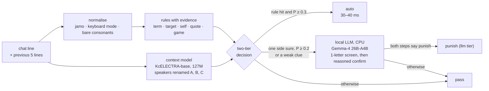

<!-- readme-v2 -->
<p align="center"></p>

<p align="center">   <a href="README.ko.md"></a></p>

<p align="center">Rules → a context model that reads the previous 5 lines → a local LLM only for the unsure lines.<br>Runs on one CPU, in production on a real game server.</p>

<table>
<tr><td align="center" width="25%"><h3>0</h3><sub>normal lines auto-punished (held-out)</sub></td><td align="center" width="25%"><h3>30–40 ms</h3><sub>per line on 4 CPU threads</sub></td><td align="center" width="25%"><h3>0.15%</h3><sub>of real chat reaches the LLM</sub></td><td align="center" width="25%"><h3>CPU only</h3><sub>no GPU needed</sub></td></tr>
</table>



### Run

```bash
pip install -r requirements.txt
python -m unittest discover -s tests          # 46 tests, no model or LLM needed
```

### Details

<details>
<summary><b>Pipeline</b></summary>

Moderation for Korean game chat that runs on a CPU. Rules with evidence catch the abusive words however they are
spelled, a fine-tuned context model reads the five lines before each message, and a local LLM looks only at the
lines the first two are unsure about. Built for a Korean Minecraft survival server whose players are mostly
teenagers; in production since October 2026.


> Content warning: the rule lexicons and the AI-written data in `data/` contain explicit Korean abuse.

</details>

<details>
<summary><b>Results</b></summary>

Held-out sets were written by an AI model and never used for training; real chat is reported as counts only.
Measured with the deployed model, which was trained on the data in this repository plus 12,500 real chat lines as
extra negatives (those lines and the weights are not published, see [Privacy](#privacy)).

| Test | Severe lines caught | Normal lines flagged |
|---|---|---|
| AI-written conversations, `blind-ctx-2` (100 severe, 200 normal) | 92 (49 auto + 43 review) | 12 review, **0 auto** |
| AI-written single lines, `blind-test-2` (120 severe, 200 normal) | 120 (71 auto + 49 review) | 2 review, **0 auto** |
| Hardest 215 of `blind-ctx-2`, with the LLM as deployed (80 severe, 135 normal) | 71 punished (30 auto + 41 LLM) | **0** |
| Real chat, latest 15% held out by time (2,632 lines) | | 2 review, 0 auto; 4 lines (0.15%) reach the LLM |
| Real incident lines (20) | 19 (18 auto + 1 review) | |
| First 17 hours in production (454 lines) | no abuse incident | 1 wrong advertising mute, reverted and fixed |

| Stage | Cost per line | Lines that reach it |
|---|---|---|
| Rules | under 1 ms, pure Python | all |
| Context model | 30–40 ms on 4 CPU threads | all |
| LLM screen (one output token) | 2.8 s average | about 0.15% of real chat |
| LLM confirm (JSON with a reason) | about 10 s more | only lines the screen flags |

Hardware: one older dual-socket server (2016-era CPUs, 22 cores per socket), no GPU, shared with the game server. No per-request fees.

</details>

<details>
<summary><b>Why it is built this way</b></summary>

**A narrow policy.** Only severe abuse aimed at another player is punished: insults about someone's family
(패드립), heavy swearing thrown at a person (쌍욕), slurs about disability, race or origin (비하) and sexual
harassment (성희롱). Swearing at a creeper, at lag or at oneself, teasing, new slang and in-game threats pass.
A ready-made Korean hate-speech classifier did not fit: `smilegate-ai/kor_unsmile` caught 19 of the 20 real
incident lines but also flagged every ordinary swear word in the test.

**Rules first, but never alone.** Players hide words with symbols, digits, filler syllables, bare consonants and
Korean typed with the keyboard in English mode. Matching on jamo strings after normalisation handles all of these
cheaply and says exactly why it matched. What rules cannot know is whether a line is aimed at someone, quotes a
report, or curses a mob. So each rule hit carries its evidence (target, self, quote, game cues), and a hit
only becomes automatic when a second, independent signal agrees.

**Context decides.** "빨리 가시라고 해 ㅋㅋ" ("tell them to hurry up and go") is harmless after "할머니가 집에
오셨어" ("grandma is visiting") and mocks a death after "할아버지 입원하셨어" ("grandpa is in hospital"). A
cross-encoder over (previous 5 lines, judged line) learns this from contrast pairs: the same line written once in a
severe and once in a harmless context. Speakers are renamed A, B, C so the model learns who talks to whom,
not who someone is.

**Two tiers.** `auto` needs both the rules and the model. Everything only one of them is sure about goes to
`review`: implicit insults that contain no listed word (rules catch 0 of 40; the model sends 32 of them to
review), rule hits the context rejects, curses that name a mob. No normal line in any test set reached `auto`.

**An LLM only where reasoning is needed.** A 26B mixture-of-experts model on a CPU takes seconds per line, so it
cannot read all chat. It reads the 0.15% of lines that the cheap stages flag. A grammar forces a one-letter answer
first (about 3 s); only a "punish" letter triggers the slow reasoned answer, and the line is punished only when
both agree.

**Everything local.** The LLM is a llama.cpp server on the same machine. Chat never leaves the host, and there is
no API bill. The system replaced a paid moderation API.

</details>

<details>
<summary><b>How each stage works</b></summary>

### Normalisation, `kcm/normalize.py`

| Trick | Example | Handling |
|---|---|---|
| symbols, digits, spaces between letters | `병.신`, `병1신`, `병 신` | `squeeze()` keeps letters only; `light()` removes up to 2 symbols between Hangul |
| full-width characters, long runs | `ＡＢＣ`, `ㅋㅋㅋㅋㅋ` | NFKC, runs cut to 2 |
| compound letters typed either way | `ㅄ` / `ㅂㅅ`, `ㅘ` / `ㅗㅏ` | `jamo()` splits every syllable and compound into single letters |
| filler syllables | `씨이발`, `병으응신` | rule patterns allow 으, 응, 이 between syllables |
| Korean typed in English mode | `qudtlsdk` = 병신아 | `engkey()` (letters for the rules), `eng2han()` (syllables for the model, only if every key forms a common syllable) |
| bare consonants | `ㄴㄱㅁ`, `ㅅㅂㄹ아` | separate abbreviation patterns |

### Rules with evidence, `kcm/rules.py`

24 patterns plus 3 bare-consonant patterns over four views of the line: spaced jamo, jamo without spaces, the
keyboard-mode reading and the bare-consonant string. `evidence()` returns the category, the view that matched and the cues:

- `target`: second-person words, a vocative ending (-아/-야), a username, 닥쳐/꺼져
- `self_talk`: the line starts with 나/내가/저는; cancels curses and slurs ("나 병신인가")
- `quote`: talks about abuse (신고, 하지마, 라고); cancels a hit unless it is also aimed at someone
- `game`: mobs, lag, the server, terrain
- special cases: the year 병신년 (2016), game phrases such as 땅따먹기, exclamations such as 엄마야
- `weak`: a cancelled hit, or body/family/disability words aimed at someone. Never punished, but sent for a
  second look.

### Context model, `kcm/context_model.py`, `scripts/train.py`

`beomi/KcELECTRA-base-v2022` (127M parameters, pre-trained on Korean online comments, so it knows the slang),
fine-tuned as a pair classifier: segment 1 is up to 5 previous lines `A: ... / B: ...`, segment 2 is the judged
line. The context is truncated from the left; the judged line never is. Training examples come from three kinds of
AI-written data plus optional real negatives:

- single severe and normal lines, each dropped into a harmless conversation and also used alone;
- conversations (severe and normal), and "rude but allowed" conversations;
- contrast data: the same line in a severe and in a harmless context, innocent lines right after someone else's
  abuse, a severe line inserted before a harmless one, keyboard-mode typing of both kinds.

Recipe: 2 epochs, batch 32, lr 3e-5, class weights 1:3, label smoothing 0.05. The deployed model had 20,234
examples (2,808 severe) and trained in 49 minutes on the CPU.

### Decision, `kcm/decide.py`

| Tier | Condition |
|---|---|
| `auto` | a rule hit, context model P ≥ 0.3, and not a curse that names a mob or object without "너/니" |
| `review` | P ≥ 0.9 without a rule hit; a rule hit with P < 0.3; a curse that may be aimed at a mob |
| to the LLM | every review line, and any line with P ≥ 0.2 or a weak clue |
| `llm` / `llm_pass` | the LLM's verdict; `llm` was punished in production, but can be routed to people instead |

### Local LLM, `kcm/llm.py`

Any llama.cpp server (`llama-server --jinja`). The policy prompt is in Korean, with five worked examples of
implicit insults and of look-alikes that pass. `screen()` answers with one letter under the grammar
`root ::= [FCSHN]`; `confirm()` answers JSON (`대상`, `이유`, `판정`, `종류`) under a JSON schema. The system prompt
stays in llama.cpp's prompt cache, so about 630 of the roughly 700 prompt tokens are not recomputed. The same server
answers two other one-letter questions: advertising another server (asked only when a line contains an address,
IP or invite hint; an allowlist of servers players may invite to is checked before the model) and user-chosen
titles.

</details>

<details>
<summary><b>Detailed results</b></summary>

### Held-out AI-written sets, deployed model

`python scripts/evaluate.py --model <dir> --llm-cache results/llm-hard-subset.json`; full output in
`results/original-model.txt`, per item in `results/original-model.json`.

| Set | Type | n | Rule hit | P ≥ 0.5 | auto | review |
|---|---|---|---|---|---|---|
| blind-ctx-2 severe | plain | 35 | 33 | 35 | 33 | 2 |
| | evasive | 25 | 16 | 25 | 16 | 9 |
| | implicit (no abusive word) | 40 | 0 | 33 | 0 | 32 |
| blind-ctx-2 normal | ordinary | 80 | 0 | 0 | 0 | 0 |
| | mild (rude but allowed) | 40 | 0 | 0 | 0 | 0 |
| | swearing at a mob | 30 | 5 | 9 | 0 | 9 |
| | innocent line after abuse, or a quoted report | 30 | 2 | 0 | 0 | 2 |
| | look-alike words | 20 | 0 | 1 | 0 | 1 |
| blind-test-2 severe | single line | 120 | 71 | 120 | 71 | 49 |
| blind-test-2 normal | single line | 200 | 0 | 3 | 0 | 2 |

Rules alone catch 49 of 100 severe conversations and 71 of 120 severe lines, with no hit on the 200 normal single
lines and 7 on the 200 normal conversations (5 curses at mobs, 2 quoted reports); the model adds the implicit
cases and keeps those 7 out of `auto`. A few judged lines also occur word for word in the training data (see
`data/README.md`). Without them (`--exclude-train-overlap`): blind-ctx-2 severe 99 → 48 auto
+ 43 review, normal 195 → 12 review; blind-test-2 severe 113 → 65 auto + 48 review, normal 189 → 2 review.

### The LLM stage

The 215 hardest items of `blind-ctx-2`: all implicit, evasive, mild, mob, after-abuse and look-alike items plus 15
random plain and 15 random ordinary ones. Same prompt, llama.cpp on 22 CPU threads, thinking off. Answers are
recorded in `results/llm-hard-subset.json` (verdicts and timings only), so the numbers can be replayed without the
model.

| Model, mode | implicit (40) | evasive (25) | plain (15) | false alarms (135 normal) | s / line |
|---|---|---|---|---|---|
| Qwen3.6-35B-A3B IQ4_XS, reasoned | 26 | 22 | 15 | 4 (all at mobs) | 9.1 |
| **Gemma-4 26B-A4B IQ4_XS, reasoned** | **38** | 21 | 15 | **0** | 10.7 |
| Gemma-4 26B-A4B, one letter | 37 | 23 | 15 | 3 of 128 * | 2.8 |
| Gemma-4 26B-A4B, two-step (deployed) | 37 | 20 | 15 | 0 of 128 * | 2.8, +10 when flagged |
| Gemma-4 E4B (5 GB) | 18 | | | 4 of 30 at mobs | 9.5 |

\* 7 look-alike items were skipped by a resume bug in the one-letter run.

Whole pipeline on the same 215 items: auto 30, sent to the LLM 46 severe and 19 normal; punished 73 of 80 with the
reasoned answer alone, 71 of 80 with the deployed two-step check; 0 of 135 normal lines punished either way.

### Real chat (counts only)

- Corpus: 20,878 public chat lines from 101 players over 10 days, labelled by hand for the first versions.
- Deployed model, time split: of the most recent 2,632 lines (never used for training), 0 auto, 2 review, 4 sent to
  the LLM.
- 20 real incident lines (most of them from one episode): 18 auto, 1 review, 1 missed.
- Production, first 17 hours: 454 lines in 400 judging batches; 399 succeeded, 1 hit a connection error while the
  service restarted and was judged in the next batch; nothing left unjudged. No abuse or harassment incident. One
  advertising false positive: a player invited others to a public PvP practice server by its nickname, which the
  policy allows; the 24-hour mute was reverted by hand and the allowlist check was added before the LLM.
- Advertising question on labelled real lines: 10 of 14 real advertisements caught, 3 of 40 look-alike normal lines
  flagged. In production a line is only asked about when it contains an address, IP or invite hint.
- When the system replaced the paid API, the 16,099 lines the API had left unjudged were marked as skipped rather
  than punished retroactively.

### Latency and memory

| Item | Measured |
|---|---|
| Context model, one line at a time | 30–40 ms, 4 threads |
| Context model, batched evaluation | 28 ms per item, 4 threads (620 items in 17 s) |
| Gemma-4 26B-A4B IQ4_XS benchmark, 22 threads | prompt 73 tok/s, generation 9.6 tok/s (Q4_K_S: 65 / 7.2, slower, dropped) |
| Reasoned answer | about 700 prompt tokens (about 630 cached) + 69 generated |
| Gemma resident memory | 14.3 GB, loaded into one NUMA node's RAM instead of mmap |
| Context model training | 20,234 examples, 2 epochs, 49 min on the CPU |

</details>

<details>
<summary><b>Versions</b></summary>

| Version | Date | Approach | Outcome |
|---|---|---|---|
| v1 | 2026-10-12 | sentence embeddings + character n-grams + logistic regression, broad policy | 21–50% recall on real chat |
| v2 | 2026-10-12 | severe-only policy, same model, hand-written examples | 9–11 of 13 lines of one real episode |
| v3 | 2026-10-12 | jamo normalisation + rules + the model | overfitted, see below |
| v4 | 2026-10-13 | rules with evidence + retrained model (+ Clef-Flash second look) | blind-test-2: 91/120 severe, 0/200 false without the second look |
| v5 | 2026-10-14 | context model + v4 rules, two tiers, Gemma second look; deployed | the tables above |

</details>

<details>
<summary><b>What failed, and why</b></summary>

**v1, a broad sentence classifier.** ko-sroberta embeddings + character n-grams + logistic regression, with a wider
policy (also cheating talk, server bashing, advertising). Five-fold cross-validation on 14,477 real lines with 96
violations: 21% recall at 5 false alarms, 27% at 20, 50% at 69. It could not see context, did not know server
names and missed new slang.

**v3 looked perfect and was overfitted.** Rules + jamo normalisation + the v1-style model scored 18/20 real incident
lines, 0 false alarms in 14,058 other real lines, 16/16 new spelling variants and 0/24 look-alikes. A fresh set of
200 AI-written lines that the rules had never seen gave 57/80 and 8 false alarms out of 120. The rules had been
tuned while looking at the same lines that scored them. Since then every change is scored on a set written after
the change, and fixes made after looking at a test set are reported as such.

**Clef-Flash (a 6.5 GB structured-question model, Q4_K_M) as the second look.** On the v3 test lines it found
17/20 real incident lines, 11/16 spelling variants and raised 6/24 false alarms at threshold 0.5 (v3: 18, 16, 0).
Without a glossary of the slang in the question it caught 4/14 advertising lines, 0/5 cheating admissions and 1/9
server-bashing lines; with the glossary 4/5 and 6/9. As the v4 second look it added catches together with false
alarms (blind-test-2: 102/120 severe and 3/200 false with it, 91/120 and 0/200 without). 8–12 s per line. It was
removed. Its replacement, Gemma-4 26B-A4B, was not run on the same lines, but on the hard subset above it caught
38 of 40 implicit insults with no false alarm.

**A smaller LLM is not faster.** Gemma-4 E4B (5 GB) caught 18 of 40 implicit insults, broke the answer format in
about half the cases and took 9.5 s per line, the same as the 26B-A4B model, which also computes only about 4B
parameters per token. The large model costs memory, not time. Qwen's thinking mode wrote over 1,500 tokens per
line (over 160 s) and was dropped.

**The first context model blamed the wrong line.** Round 1 flagged innocent lines right after someone else's abuse
and curses at mobs. Round 2 added the contrast pairs and innocent-after-abuse examples; round 3 added real chat as
negatives and the "rude but allowed" set.

**Background priority halved the LLM.** Running at the lowest CPU weight next to the game server gave half the
benchmark speed (prompt 28 tok/s, generation 6.4 tok/s), and writing the reason took most of the time. A slightly
higher weight plus the one-letter screen brought the average to 2.8 s.

**An allowlist belongs in code.** The advertising false positive above came from a nickname the prompt did not know.
Policy exceptions are now checked by a pattern before the model is asked.

</details>

<details>
<summary><b>Limitations</b></summary>

- The test sets were written by the same kind of model as the training sets, so they share a style. Real-chat
  evidence is small: 20 incident lines and 2,632 held-out lines from one server.
- Implicit insults never reach `auto`; they depend on review or on the LLM (37 of 40 in the hard subset).
- Swearing at mobs still creates review work (9 of 30 mob lines).
- The model over-weights some phrases: in a probe, a compliment about someone's mother ("니 엄마 요리 잘하시네"
  after "우리 엄마 요리사임") reached `auto` at P 0.99, because the rule for 니엄마 fired as well.
- Policy is one server's. The thresholds (0.3 / 0.9 / 0.2) were chosen by hand during development.
- Spam is not handled here; the host service counted 5+ near-identical lines from one player within 10 s.
- A model trained only on the data in this repository has not been measured; expect lower precision on real chat
  without your own negatives (`--negatives`).

</details>

<details>
<summary><b>Privacy</b></summary>

Chat logs with usernames are personal information under Korea's Personal Information Protection Act. This
repository therefore contains no real chat line, username, UUID, IP or server address. Real chat was used only on
the server's own machine: as negatives during training and for the counts above. The deployed weights are not
published because they were trained on that chat and could reproduce parts of it. The data in `data/` is
AI-written, with every username replaced by a placeholder; see `data/README.md` for how it was checked against the
real log before publication. The LLM runs locally, so moderated chat never leaves the host.

</details>

<details>
<summary><b>How to run</b></summary>

Python 3.10+. The rules need no packages; the context model needs PyTorch and Transformers.

```bash
pip install -r requirements.txt
python -m unittest discover -s tests          # 46 tests, no model or LLM needed

# judge one line (rules only)
python -m kcm.judge "qudtlsdk"
python -m kcm.judge "니 엄마 요리 잘하시네" --prev "Player1: 우리 엄마 요리사임" --speaker Player2

# train a context model on the AI-written data, optionally with your own ordinary chat as negatives
python scripts/train.py --out models/ctx [--negatives my-chat.txt] [--threads 16]
python scripts/train.py --dry-run             # count the examples only

# evaluate: rules only, then with the model, then replaying the recorded LLM answers
python scripts/evaluate.py
python scripts/evaluate.py --model models/ctx --llm-cache results/llm-hard-subset.json

# with a local LLM (any GGUF build of Gemma-4 26B-A4B instruct; IQ4_XS is 13.6 GB)
llama-server -m gemma-4-26b-a4b-it-IQ4_XS.gguf --jinja -c 8192 -t 22 --parallel 1 --port 8080
python -m kcm.judge "..." --prev "Player1: ..." --model models/ctx \
    --llm-url http://127.0.0.1:8080/v1/chat/completions
```

`--negatives` formats: `.txt` with one `name: text` line per row, oldest first, an empty row between
conversations; or `.jsonl` with `{"prev": [...], "msg": "name: text"}` per row. Lines the rules flag are skipped,
because unlabelled chat may contain real abuse.

Example output (rules only):

```
$ python -m kcm.judge "qudtlsdk"
verdict  : no action
tier     : review
category : targeted_curse (쌍욕)
reason   : rule engkey targeted_curse (no context model loaded)
evidence : target
```

In Python:

```python
from kcm import Judge
from kcm.context_model import ContextModel
from kcm.llm import LLMJudge

judge = Judge(ContextModel('models/ctx', threads=4),
              LLMJudge('http://127.0.0.1:8080/v1/chat/completions', allowed_servers=['practice.example']))
result = judge(['Player1: 너 왜 내 상자 열었냐'], 'Player2: 안 열었는데 ㅋㅋ')
# dict: punish, tier ('auto' | 'review' | 'llm' | 'llm_pass' | 'pass'), category, p, reason, evidence,
#       plus 'llm' when the LLM was asked and 'advertising' when the line had an address hint
```

</details>

<details>
<summary><b>Layout</b></summary>

```
kcm/
  normalize.py       jamo, clean/squeeze/words, keyboard-mode readings
  rules.py           lexicons, patterns, evidence()
  context_model.py   input format (encode) and the KcELECTRA scorer
  decide.py          two-tier decision and the Judge pipeline
  llm.py             llama.cpp client: screen, confirm, advertising, titles
  cli.py, judge.py   python -m kcm.judge
scripts/
  train.py           fine-tune on data/train (+ optional negatives)
  evaluate.py        held-out sets; optional LLM replay or live LLM
data/                AI-written training and test sets (content warning, see data/README.md)
results/             recorded LLM answers and the deployed model's per-item results
tests/               unit tests: normalisation, rules, decision, input format, LLM client (stub server)
```

</details>

<details>
<summary><b>Licence</b></summary>

MIT. See `LICENSE`.

</details>


<p align="center"><sub>Made by <a href="https://github.com/jayden0903">jayden0903</a> · no real chat or weights published</sub></p>
